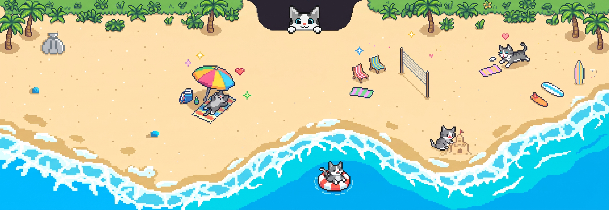
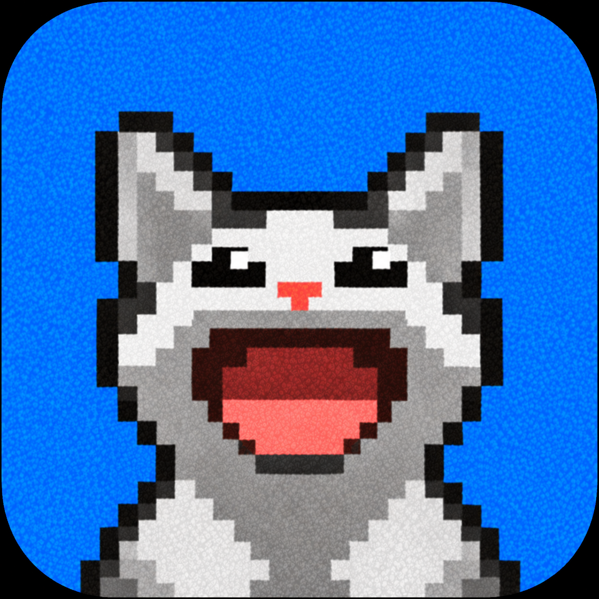
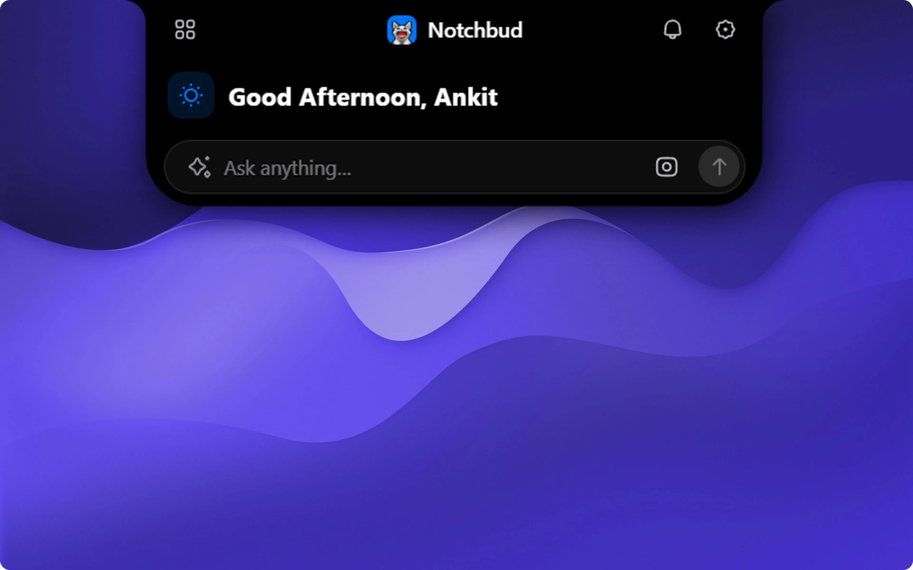
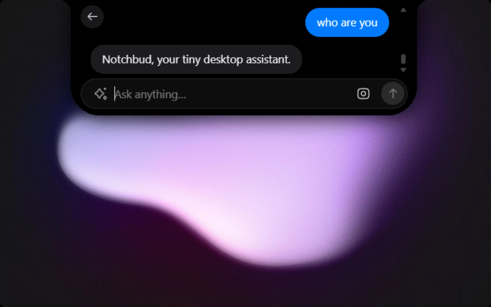

# notchbud

**The notch with an assistant. Hover, ask, get answers right on your desktop.**

[Download](#download) · [How to use](#how-to-use) · [Privacy](#privacy) · [FAQ](#faq)

---

## What is this?

notchbud adds a small island to the top of your Windows screen. Hover it, type a question, and the answer streams right there. No browser tab, no switching windows.

It uses your own Groq API key. There is no notchbud server in between.

<table align="center">
<tr><td align="center"><b>Island</b></td></tr>
<tr><td></td></tr>
<tr><td align="center"><u>The island at rest. It sits slim at the top until you hover it.</u></td></tr>
</table>

 

<table align="center">
<tr><td align="center"><b>Answering</b></td></tr>
<tr><td></td></tr>
<tr><td align="center"><u>Hover to expand, type your question, and watch the answer stream in live.</u></td></tr>
</table>

 

<table align="center">
<tr><td align="center"><b>History</b></td></tr>
<tr><td></td></tr>
<tr><td align="center"><u>Your recent exchange stays in the island for reference.</u></td></tr>
</table>

## Features

- Hover the notch to open it. No click needed.
- Type while your current window stays focused.
- Answers stream in live. Move away to stop.
- Works with your own Groq key. Paste it once.
- Simple installer. No admin rights needed.

## Download

1. Go to [Releases](https://github.com/ankitdey01/notchbud/releases).
2. Download `Notchbud-Setup-0.1.3.exe` and run it.
3. Hover the notch and paste your Groq key from [console.groq.com/keys](https://console.groq.com/keys) when asked.

Needs Windows (64 bit), WebView2 Runtime, and a Groq API key.

## How to use

1. Hover the notch at the top of the screen.
2. Type your question.
3. Press Enter and read the answer as it streams in.
4. Move your mouse away to close it and stop the reply.

Your recent chat stays in the island. Extra options live in the tray icon.

## Privacy

- Answers are billed to your own Groq key.
- Your key stays on your PC. It is never shared with anyone except Groq.
- No notchbud account. The app talks directly to Groq.

## Contributing

Issues and PRs are welcome. See [CONTRIBUTING.md](./CONTRIBUTING.md) for setup, checks, and releases.

## License

No LICENSE file is included yet, so all rights are reserved for now. Open an issue if you want to reuse this code.

## FAQ

<b>Is it really free?</b>

Yes. The app costs nothing and has no paid plan. Answers are billed to your own Groq key, so Groq's own pricing applies to your usage.

<b>Do I need admin rights?</b>

No. The installer is per user and never asks for elevation.

<b>Where is my API key stored?</b>

In a protected file on your own PC, under `%APPDATA%\notchbud`. It is only ever sent to Groq, never anywhere else.

<b>Does it work offline?</b>

No. Answers stream from Groq, so you need an internet connection.

<b>How do I sign out or wipe my data?</b>

Pick Disconnect in the tray menu to sign out. If you uninstall, the uninstaller asks whether to delete your sign-in data too.

---

**If the notch made you smile, give it a star.**

