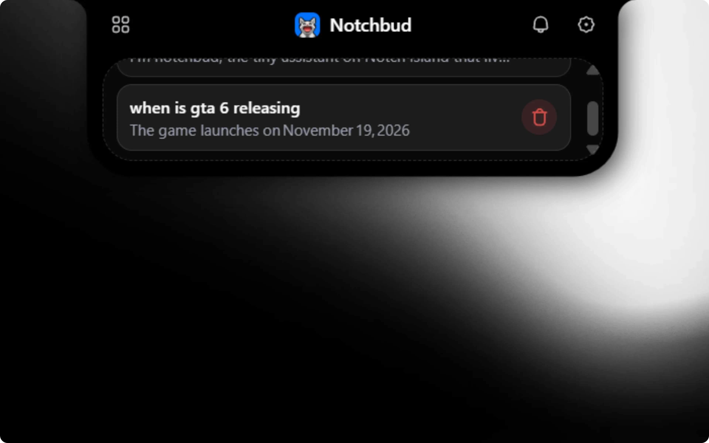
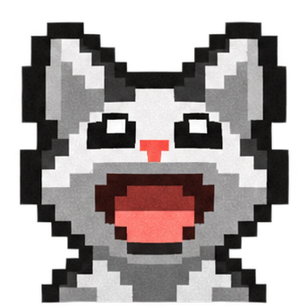

# notchbud

**The notch with an assistant. Hover, ask, get answers right on your desktop.**

[Download](#download) · [How to use](#how-to-use) · [Privacy](#privacy) · [FAQ](#faq)

---

## What is this?

notchbud adds a small island to the top of your Windows screen. Hover it, type a question, and the answer streams right there. No browser tab, no switching windows.

It uses your own Groq API key or an OpenAI-compatible custom endpoint. There is no notchbud server in between.

<table align="center">
<tr><td align="center"><b>Island</b></td></tr>
<tr><td></td></tr>
<tr><td align="center"><u>The island at rest. It sits slim at the top until you hover it.</u></td></tr>
</table>

 

<table align="center">
<tr><td align="center"><b>Answering</b></td></tr>
<tr><td></td></tr>
<tr><td align="center"><u>Hover to expand, type your question, and watch the answer stream in live.</u></td></tr>
</table>

 

<table align="center">
<tr><td align="center"><b>History</b></td></tr>
<tr><td></td></tr>
<tr><td align="center"><u>Your recent exchange stays in the island for reference.</u></td></tr>
</table>

## Features

- Hover the notch to open it. No click needed.
- Type while your current window stays focused.
- Answers stream in live. Move away to stop.
- Works with your own Groq key or a custom base URL, model ID, and optional API key.
- Simple installer. No admin rights needed.

## Download

1. Go to [Releases](https://github.com/ankitdey01/notchbud/releases).
2. Download the setup exe from the latest release and run it.
3. Hover the notch and choose **Groq API key** or **Custom endpoint**.
   - Groq: paste a key from [console.groq.com/keys](https://console.groq.com/keys). The chat model is picked automatically.
   - Custom, in three short steps: the provider's API root in step 1 (include `/v1` when required, e.g. `https://api.example.com/v1`), an optional API key in step 2, and the exact model ID in step 3 (pick from the fetched list or type it; Up/Down cycles the list).

Needs Windows (64 bit), WebView2 Runtime, and a compatible model provider. Custom endpoints must support OpenAI Chat Completions with streamed SSE responses. Remote URLs require HTTPS; HTTP is allowed only for local servers.

Choosing Next after the key checks it against the provider's `/models` endpoint before showing models. A rejected key keeps you on the key step with the error so you can fix it and retry; anything else advances, and the model list fills in when the check succeeds. An unreachable endpoint still lets you save — the connection stays unverified and the first chat reports any problem. The list hides non-chat entries (speech, safety, TTS, embeddings) — if your model isn't listed, just type its ID manually. Providers with public model catalogs may still require additional permissions for chat.

Only one provider is active at a time. Leaving the key blank keeps the saved key for the same base URL; a blank key on a new URL means no authentication (for local servers like Ollama or LM Studio).

## How to use

1. Hover the notch at the top of the screen.
2. Type your question.
3. Press Enter and read the answer as it streams in.
4. Move your mouse away to close it and stop the reply.

Your recent chat stays in the island. Extra options live in the tray icon.

Switch providers or edit the connection from Settings (gear icon) → Edit connection — the current connection keeps working until the replacement saves. Disconnect signs out and removes the saved login. The camera button attaches a screenshot to your next question: on Groq it is read by the vision model automatically, on Custom it is sent to your selected model, which must accept images.

## Privacy

- Provider usage is billed or limited by your own Groq key or custom provider.
- Your key stays on your PC. It is sent only to the configured provider; keyless local endpoints are supported.
- No notchbud account. The app talks directly to Groq or your custom endpoint.
- Custom mode does not add web search; on Groq, supported models can search the web server-side. Screenshot support depends on the selected model.
- Switching providers keeps the local conversation, so its history is included in the next request to the newly selected provider.
- Saved logins are sealed with Windows DPAPI and never exposed to the island's scripts. Step-2 key checks and failed chats never print your key: error text is redacted before display.

## Contributing

Issues and PRs are welcome. See [CONTRIBUTING.md](./CONTRIBUTING.md) for setup, checks, and releases.

## License

No LICENSE file is included yet, so all rights are reserved for now. Open an issue if you want to reuse this code.

## FAQ

<b>Is it really free?</b>

Yes. The app costs nothing and has no paid plan. Model usage is billed or limited by your configured provider, so that provider's own pricing and subscription rules apply.

<b>Do I need admin rights?</b>

No. The installer is per user and never asks for elevation.

<b>Where is my API key stored?</b>

In a protected file on your own PC, under `%APPDATA%\notchbud`. It is only ever sent to the configured Groq or custom endpoint. Saved keys are never exposed to the island's JavaScript.

<b>Does it work offline?</b>

Groq and hosted custom providers need an internet connection. A model server running on your own PC can work offline.

<b>How do I sign out or wipe my data?</b>

Pick Disconnect in the tray menu (or Settings → Sign out) to sign out. If you uninstall, the uninstaller asks whether to delete your sign-in data too.

<b>Which models show up in the Custom list?</b>

Whatever the provider's `/models` endpoint returns, minus speech, safety, TTS, transcription, and embedding entries, which can't back a chat. If your model isn't listed, type its exact ID manually.

<b>Why did an update sign me out?</b>

The saved-login format changed when Custom endpoints were added, so that update discards the old file once and asks you to sign in again. It won't repeat on later updates.

---

**If the notch made you smile, give it a star.**

